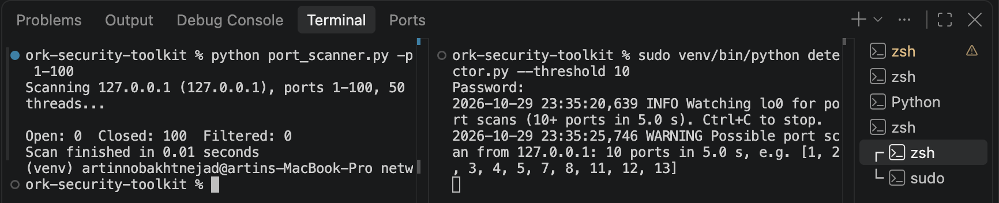

# Network Security Toolkit

A Python toolkit that plays both sides of a network attack: a multithreaded **port scanner** that finds open services and flags risky ones, and a **port scan detector** (a small intrusion detection system) that catches scans in live traffic or saved captures.

I built it from scratch with Python sockets and Scapy to learn how tools like Nmap, Wireshark and Snort work underneath.



> ⚠️ Only scan or capture traffic on systems you own or have permission to test. See [Ethics and legal use](#ethics-and-legal-use).

## Features

- **Port scanner** (`port_scanner.py`): TCP connect scan with 50 threads, open / closed / filtered port states, banner grabbing, and warnings for risky services and outdated software versions
- **Scan detector** (`detector.py`): flags any IP that knocks on many ports within a short time window, logs timestamped alerts to `alerts.log`, and works on live traffic or saved `.pcap` files
- **Packet capture** (`capture.py`): records SYN packets to a `.pcap` file using a BPF filter

## Demo

Scanning Nmap's official practice server:

```
$ python port_scanner.py scanme.nmap.org
Scanning scanme.nmap.org (45.33.32.156), ports 1-1024, 50 threads...

PORT    SERVICE        BANNER
22      SSH            SSH-2.0-OpenSSH_6.6.1p1 Ubuntu-2ubuntu2.13
        WARNING: OpenSSH 6.6 is outdated (older than 8.0).
80      HTTP           Apache/2.4.7 (Ubuntu)
        WARNING: Apache 2.4.7 is outdated (older than 2.4.50).

Open: 2  Closed: 0  Filtered: 1022
Scan finished in 21.04 seconds
```

The detector catching a scan of my own Mac:

```
$ sudo venv/bin/python detector.py --threshold 10
2026-10-29 23:19:52,584 INFO Watching lo0 for port scans (10+ ports in 5.0 s). Ctrl+C to stop.
2026-10-29 23:20:00,614 WARNING Possible port scan from 127.0.0.1: 10 ports in 5.0 s, e.g. [1, 2, 3, 4, 5, 6, 7, 9, 10, 11]
```

## How it works

### Scanning: the TCP 3-way handshake

| Scanner sends | Target replies | Port state |
| --- | --- | --- |
| SYN | SYN-ACK | **Open**: a program is listening |
| SYN | RST | **Closed**: the host is up, but nothing listens there |
| SYN | nothing (timeout) | **Filtered**: a firewall dropped the packet |

`connect_ex` returns 0 for open, `ECONNREFUSED` for closed, and a timeout code for filtered. Ports are scanned in parallel with `ThreadPoolExecutor`: 1,024 filtered ports at a 1-second timeout would take about 17 minutes one at a time, and take 21 seconds with 50 threads.

### Banner grabbing and warnings

SSH sends its banner as soon as you connect. Web servers wait for a request, so the scanner sends `HEAD / HTTP/1.0` and reads the `Server:` header. Version numbers are pulled out with regular expressions and compared as tuples, so `(2, 4, 7) < (2, 4, 50)` is correct (comparing the text `"2.4.7"` and `"2.4.50"` would get it wrong). Services such as Telnet, FTP, SMB and RDP get a warning just for being open.

### Detection: a sliding time window

For every SYN without ACK (a connection attempt), the detector adds `(time, port)` to that source IP's `deque`, drops entries older than the window, and counts the distinct ports. If the count reaches the threshold, it raises one alert. A cooldown stops a single scan from producing hundreds of duplicate alerts (alert fatigue).

## Results and limitations

- The scanner finds the same open ports on scanme.nmap.org (22 and 80) as Nmap does.
- The detector caught every fast scan in testing, live and from a saved capture, and stayed quiet for single connections.
- **Small or slow scans can slip through.** A 15-port scan stayed under the default threshold of 20 (a false negative). Lowering the threshold catches it but risks false positives, the same precision / recall tradeoff as an ML classifier threshold.
- The version check uses simplified minimum versions, not a CVE database. Linux distributions often backport security fixes without changing the version number, so a banner means "possibly vulnerable", not "confirmed vulnerable".
- Only TCP connect scans; no SYN (half-open) or UDP scanning.

## Future improvements

- Look up real vulnerabilities for each version with the NVD (CVE) API
- Detect slow scans with a second, longer time window
- UDP scanning
- Export scan results as JSON
- Unit tests with pytest

## Run it

```bash
git clone https://github.com/artinnobakhtnejad/network-security-toolkit.git
cd network-security-toolkit
python3 -m venv venv
source venv/bin/activate
pip install -r requirements.txt
```

```bash
python port_scanner.py                        # scan your own computer, ports 1-1024
python port_scanner.py scanme.nmap.org -p 1-100
python port_scanner.py --help

sudo venv/bin/python detector.py              # watch loopback (lo0) for scans
python detector.py --pcap capture.pcap        # analyze a saved capture
```

Capturing live packets needs admin rights, so the detector and `capture.py` run with `sudo`. Because `sudo` does not keep the virtual environment active, use the full path `venv/bin/python`.

## Project structure

```
network-security-toolkit/
├── port_scanner.py    # threaded scanner and command-line interface
├── banners.py         # banner grabbing (SSH and HTTP)
├── services.py        # port names, risky ports, version checks
├── detector.py        # port scan detector (live or pcap)
├── capture.py         # save SYN packets to a .pcap file
├── requirements.txt
└── learning/          # the small scripts I wrote while learning each step
```

## Ethics and legal use

I only scanned and captured traffic on my own Mac, my own home network, and `scanme.nmap.org`, which the Nmap project provides for practice scanning. Scanning systems without permission can break laws such as Section 342.1 of Canada's Criminal Code (unauthorized use of a computer), and intercepting other people's communications is a crime under Section 184. To keep mistakes harmless, the scanner's default target is `127.0.0.1`, and `.pcap` captures and alert logs are excluded from Git because they can contain private data.

## What I learned

- How the TCP handshake, ports and firewalls behave on a real network
- Why threading matters for network tools that spend most of their time waiting
- Reading packets layer by layer (Ethernet, IP, TCP) and filtering with BPF
- Thinking like both an attacker and a defender, and the tradeoff between false positives and false negatives

## Tech stack

Python 3.15 · `socket` · `concurrent.futures` · `argparse` · `re` · `logging` · Scapy 2.8.0 · BPF filters

## Author

**Artin Nobakhtnejad**, Computer Science (Co-op) student at York University

[LinkedIn](https://linkedin.com/in/artin-nobakhtnejad) · [GitHub](https://github.com/artinnobakhtnejad)

Also see my [Phishing URL Detector](https://github.com/artinnobakhtnejad/phishing-detector), a machine learning project.